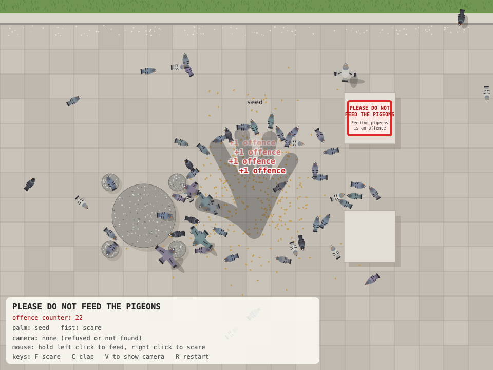
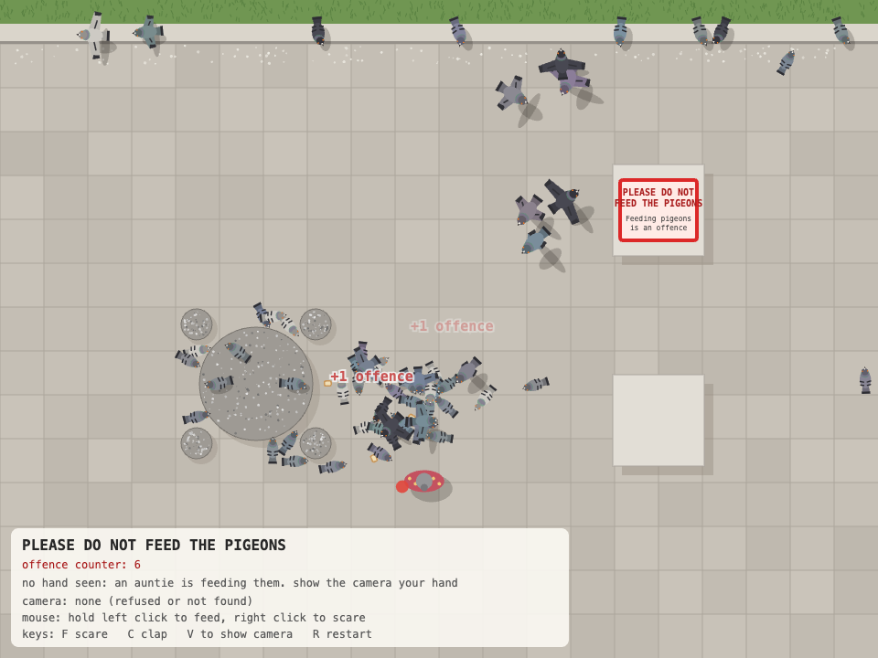
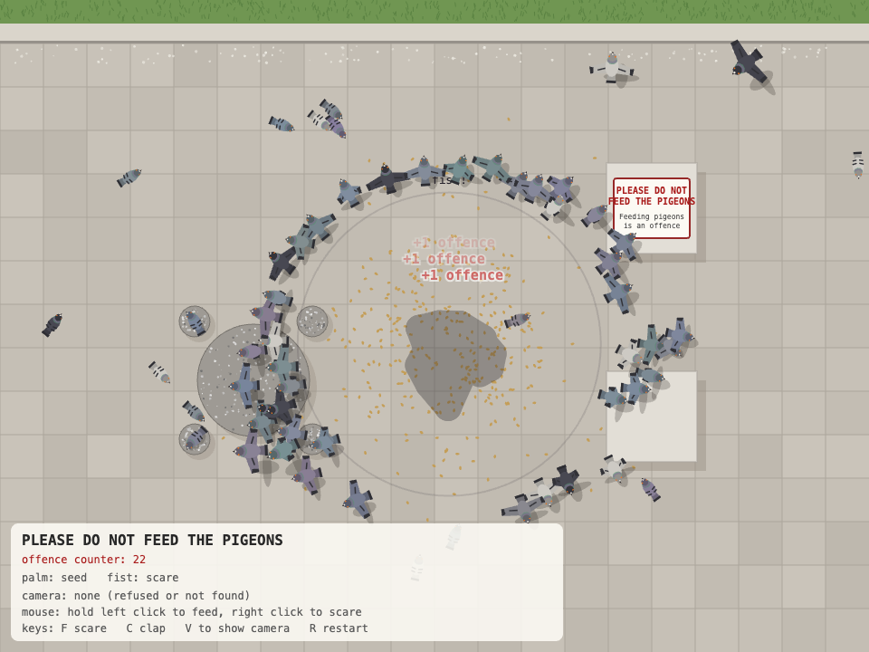

# Please Do Not Feed The Pigeons

Sidney Ngai, DM3008 Generative Art, Week 6: Autonomous Agents



Demo video: `pigeons-demo.webm` (to be added: feeding with an open palm, a fist scaring the flock, the flock resettling, then the auntie taking over once the hand is gone)

## Synopsis

A flock of pigeons lives at the void deck of an HDB block. Left alone, they walk about in
short bursts with their heads bobbing, peck at whatever is on the floor and sit along the
corridor railing.

Feeding pigeons is against the law in Singapore. What I found funny is how little it takes
to break that law here. You don't have to do anything on purpose. If the webcam can see
your hand, seed falls from it, and "+1 offence" keeps rising from your hand until you
stop. Put both hands up and it looks like you're surrendering to the police, while seed
pours out of both of them.

Keeping your hands clean is harder. To stop feeding them you have to close your hand into
a fist, which scatters the flock as well, or let go of the mouse and right click. Leaving
the sketch alone doesn't work either. If nobody touches anything for a few seconds, an
auntie walks in with a plastic bag of bread and feeds them for you, which is how it
usually goes at a real void deck.

The pigeons don't care whose food it is. They walk over to it and stay just out of reach
of your hand. When something scares them, one takes off and its neighbours follow, so
the scare spreads across the floor as a wave. They fly a few laps around the block and
come back down in small groups, mostly where the seed is.

## How to interact

| Do this | What happens |
| --- | --- |
| Any hand that isn't a fist | Seed falls around your hand. Pigeons walk over to eat but keep away from the hand. |
| Fist | Stops the seed and scares the pigeons near your hand. The ones closest go first and their neighbours follow. |
| Hold the left mouse button | Seed falls at the mouse, for when there is no camera. |
| Right click, or `F` | Scare at the mouse. |
| `C` | A clap: the whole flock goes up at once, the ones in the middle first. |
| `V` | Show or hide the camera, mirrored, beside the sketch (below it on a narrow window). |
| `R` | Restart. |

If no hand, mouse or key has been used for three seconds, the auntie comes. She walks in,
throws pieces of bread for a while and leaves. The pigeons rush the bread and fight over
it, which they never do over seed. Between her visits a motorbike goes past, a door
slams or a kid runs through, and the pigeons react to that too. This means the sketch
keeps going with no camera at all.



## How it works

Each pigeon is one of the starter's boids with a state: on the floor, in the air or
perched. The state decides which rules it follows.

**On the floor** a pigeon walks in bursts: it picks a direction, walks for a second or
so, stands still for a bit, then picks again. Its head bobs in time with its steps. Every
few frames it looks for the nearest seed it can see and walks to it using the starter's
`seek()`. When it gets there it stops and pecks for half a second. The auntie throws
pieces of bread instead of seed. Pigeons treat bread as closer than it is and hurry to
it, it takes longer to eat, and if a second pigeon arrives while one is eating, one of
them gets shoved off in a short hop. If a hand comes down right on top of a pigeon, it
hops out of the way. Walking pigeons only keep apart from each
other with a small separation, and they get pushed out of the table, stools and pillars.

**Startle and resettle.** A scare does not lift every pigeon at once. Each one gets a
short delay that is longer the further it is from the scare. When a pigeon takes off it
flaps hard for a moment, and each neighbour within 45 px has a 60% chance (`CONTAGION`)
of following a fraction of a second later. The wave comes from that chain of neighbours.

**In the air** the pigeon runs the starter's three rules: separation, alignment and
cohesion, counting only other flyers. I added a force that makes them fly laps around
the middle of the void deck, the way pigeons circle a block before coming down. After a
few seconds each one chooses where to land: near seed if there is any, otherwise the
railing, the table or a bit of open floor. Pigeons flying close to it come down to the
same place, which is why they land in small groups. While landing they slow down and the
wings beat faster to brake.

**Perched** pigeons sit still and turn their heads. They come down when they get bored or
when they see seed on the floor.

**Height.** Every pigeon has a height `z`, from 0 on the floor to 1 in the air. It is
drawn a little bigger the higher it is, and its shadow falls further away from it. From
straight above, that is what makes a flying pigeon read as flying.

**The hand.** ml5's handPose gives 21 points for each hand. The sketch reads the gesture
from those points. A finger counts as out when its tip is further from the wrist than its
middle joint is. A hand with no fingers out is a fist, and any other hand counts as open,
so it drops seed. The gesture only changes when three of the last five frames agree, which stops it
flickering. The hand is drawn as a soft shadow on the floor, and pigeons in the air and on
the ground steer away from it.



## What I changed from the Boids starter

The starter was a flock of triangles that wrapped around the edges, with keys to switch
between separation, alignment and cohesion and a mouse button to make them follow the
cursor. For the weekly assignment I only changed the colours and sizes.

- **States.** The boid became a pigeon with three states. Separation, alignment and
  cohesion are now passed their distances and only count pigeons in the same state, so
  pigeons on the floor do not try to align with ones flying overhead. The full flocking
  rules only run in the air.
- **Floor behaviour**, all new: walking in bursts, head-bob, looking for seed, pecking,
  fighting over the auntie's bread, hopping out from under a hand, going around the
  furniture.
- **Startle and resettle**, all new: the delayed wave, the chain reaction between
  neighbours, laps around the block, choosing a place to land and landing in groups.
- **Edges.** The starter wrapped boids round to the other side. Flying pigeons now turn
  back, and walking ones stay on the floor.
- **The hand** replaces the mouse follow. The webcam hand, the mouse and the auntie are
  all treated the same way, as a "feeder" with a position and a size that the pigeons
  avoid.
- **Drawing.** The triangle is replaced by a top-down pigeon: grey-blue body (with some
  dark and some pale birds, as in a real flock), the two black bars on each wing, the
  green and purple sheen on the neck, a white patch above the beak, a dark band on the
  tail, and wings that open and beat in the air. The void deck is drawn once into a
  graphics buffer: floor tiles, the parapet with droppings under it, the stone table and
  stools, and the pillars.
- **Removed:** the key switching, the momentum and separation lines, the mouse follow and
  the instructions text.

Four functions are used as they were in the template (`Flock()`, `addBoid()`,
`applyForce()` and `seek()`). Twelve started from the template and were changed: Flock's
`run()`, `Pigeon()` (the template's `Boid`), the pigeon's `run()`, `flock()`, `update()`,
`borders()`, `separate()`, `align()`, `cohesion()`, `setup()`, `draw()` and
`keyPressed()`. Every other function is new. The same list is in the Attributions part of
the header in `sketch.js`.

## Context

Craig Reynolds' boids (1987) showed that a flock needs no leader, only three local rules.
I kept those rules for the flock in the air, but most of what makes these look like
pigeons happens on the ground, where they are not flocking at all. They spread out,
ignore each other, and only act together when something scares them. The startle wave is
the moment the separate birds turn back into a flock.

The sign does not give a fine. The old pigeon rules set it at $500, and it has been raised
under the Wildlife Act since. What interested me more than the number was that a fine is
the only tool the estate has. Nobody can stop the pigeons from coming. All the estate can
do is try to change the feeder.

## Running it

The webcam and the hand model only work when the sketch is served over HTTP, so open it
through a local web server rather than as a file:

```
cd DoNotFeedThePigeons
python3 -m http.server 8000
```

then visit `http://localhost:8000` and allow the camera. p5.js 1.11.11 and ml5.js 1.2.1 are
loaded from the internet, and the hand model is downloaded by ml5 the first time, so it
needs a connection. It works best with your hand 40 to 70 cm from the camera in good
light. If the camera is refused or missing, the readout says so and the auntie and the
mouse still work.

## Files

```
DoNotFeedThePigeons/
  index.html      loads p5.js, ml5.js and sketch.js
  sketch.js       the whole piece, with the synopsis and attributions in its header
Images_Videos/
  README.md            this write-up
  pigeons-palm.png     an open palm scattering seed
  pigeons-scare.png    a fist, with the startle wave spreading out
  pigeons-auntie.png   the auntie feeding them with no hand at the camera
  pigeons-demo.webm    screen recording (to be added)
```

## Attributions

- The Flock and Boid structure, `applyForce()`, `seek()`, and the separation, alignment
  and cohesion rules come from the Boids template (DM3008 week 6 class material, Ashley
  Hi), which follows Daniel Shiffman's *The Nature of Code* version of Craig Reynolds'
  boids.
- Hand tracking is [ml5.js](https://ml5js.org) 1.2.1 handPose, which runs Google's
  MediaPipe Hands model.
- Built with [p5.js](https://p5js.org) 1.11.11.
- The pigeon behaviour, the gestures, the auntie, the void deck and all of the drawing
  are my own. There is no outside data.
