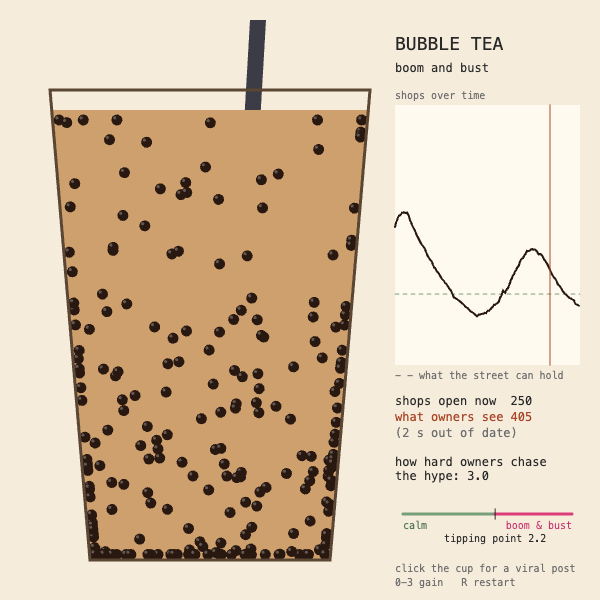
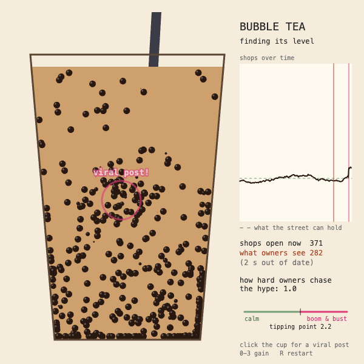
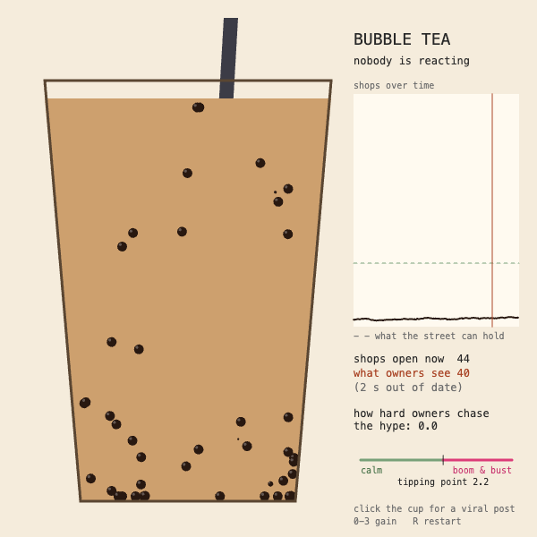
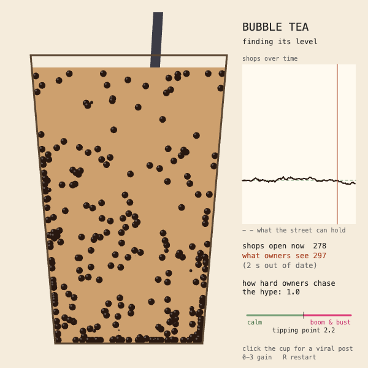

# Bubble Tea

Sidney Ngai, DM3008 Generative Art, Week 7: Cybernetics & Emergence

Stance: Conditions (after Ian Cheng)



Demo video: [bubble-tea-demo.webm](bubble-tea-demo.webm) (about 60 s: the street settles at gain 1, a viral post sets off a boom and a crash, then the slider goes past the tipping point)

## Synopsis

Every pearl in the cup is a bubble tea shop. New shops open right next to existing ones,
because a copycat is the easiest business plan there is. Every shop also has a small
chance of closing each moment. Owners open a shop when the street looks like it has
room for one, but what they see is always a little out of date, so the whole street is
reacting to old news.

Singapore has watched this happen more than once: a craze, a shop on every corner,
queues around the block, then shutters and "for lease" signs. I wanted a piece where
you can watch that happen without anyone deciding it. Nobody in the system is foolish.
Every owner follows a sensible rule: open when the market looks under-served, hold off
when it looks crowded. The boom and the crash come from the delay between looking and
acting.

You are part of the loop too. A slider sets how hard owners chase the hype, and
clicking the cup is a viral post: a wave of copycat shops opens all at once. For the
next two seconds the street is still acting on what it saw before the wave, so it keeps
opening shops, overshoots, and then crashes. You can start the boom, but after that you
can only watch it play out.

## How to interact

| Do this | What happens |
| --- | --- |
| Drag the slider | Sets how hard owners chase the hype (the gain). The bar under it shows the calm side, the boom-and-bust side, and the tipping point between them. |
| Click inside the cup | A viral post: 60 copycat shops open where you clicked, and a pink tick marks it on the chart. |
| `0` `1` `2` `3` | Jump the slider to that gain. |
| `R` | Restart with a fresh street. |

The starting gain can also be set in the address: `index.html?gain=3`.



Things to try:

- Leave the slider at 1 and wait for the street to settle on the dashed line. Then click
  the cup. The street keeps opening shops after the post, crashes below the line, and
  then calms down again.
- Do the same with the slider at 2. The crash takes a long time to die away.
- Slide slowly past the tipping point (2.2) and watch the swings start and never stop.
- Set the slider to 0. Nobody reacts to anything, so the street just drifts, and a viral
  post simply stays.

## How it works

The sketch keeps the three-step loop from the Steersman starter, every frame:

1. **`sense()`** records how many shops are open and hands back the count from 120
   frames (2 seconds) ago. That old number is all the street knows about itself.
2. **`update()`** turns that old number into a chance of opening a new shop. A shop
   that opens is placed next to an existing one, then every shop has a 0.4% chance of
   closing.
3. **`render()`** draws the cup, the pearls, and a chart of shops over time. A red
   line on the chart marks the moment the street is reacting to, a dashed line marks
   what the street can really hold, and pink ticks mark viral posts.

The opening rule is:

```js
pOpen = constrain(CLOSE_CHANCE + REACT * gain * (HOLD - pastPop), 0, 0.03);
```

At `HOLD` (300 shops), openings exactly balance closings. Below it, owners open more
shops; above it, fewer. `gain` is how strongly they react to the hype.

| Gain | What happens |
| --- | --- |
| 0 | Nobody reads the news. Openings always equal closings on average, so the street just drifts. |
| 1 | It overshoots a little, then settles at what the street can hold. |
| 3 | It booms past the dashed line, crashes below it, and never settles. |

| Gain 0 | Gain 1 | Gain 3 |
| --- | --- | --- |
|  |  |  |

## What I changed from the walkthrough, and why

The Conditions stance in the walkthrough uses this rule:

```js
pBirth = constrain(0.01 * (1 - gain * pastPop / 300), 0, 0.02);
```

The walkthrough says gain 1 levels off and gain 3 swings. When I tested it, the two
settled the same way, just at different sizes. Working it out showed why. Births equal
deaths when `pastPop = 180 / gain`, so the gain sets the level (180 shops at gain 1,
60 at gain 3). But how hard the loop pulls back towards that level is the slope of the
rule times the population, `0.01 * gain / 300 * 180 / gain = 0.006` per frame. The gain
cancels out. Every gain has the same strength of correction, so every gain behaves the
same way.

Whether a delayed loop like this settles or swings depends on the strength of the
correction multiplied by the delay. For a delay of `T` frames and a correction of `k`
per frame, it settles smoothly when `k * T` is small, overshoots and settles above
about 0.37, and swings for ever once `k * T` passes about 1.57 (π/2). The walkthrough's
rule gives `0.006 * 120 = 0.72` at every gain: always a small overshoot that settles.

So I rewrote the rule so that gain multiplies the reaction and the level is fixed at
`HOLD`. Now the strength of the correction is `REACT * gain * HOLD = 0.006 * gain`, and:

| Gain | k * T | Behaviour |
| --- | --- | --- |
| 1 | 0.72 | overshoots a little, then settles |
| 2 | 1.44 | rings for a long time before settling |
| 3 | 2.16 | booms and crashes for ever |

This made the gain mean something in the story: it is how hard shop owners chase the
hype, and chasing it hard on old information is exactly what causes the crash.

The tipping point is where `0.006 * gain * 120` reaches π/2, so gain = π/2 ÷ 0.72 ≈ 2.2.
The sketch works this out from its own settings (`TIP` in `setup()`) rather than
hard-coding it. If you change `DELAY`, `HOLD` or `REACT`, the marker under the slider
moves to the right place by itself. A longer delay pulls the tipping point lower: owners
acting on staler news only need to chase the hype a little before the street starts to
swing.

Other changes:

- **Copycats.** A new shop opens next to the shop that "inspired" it, so busy patches
  of the cup get busier, as they do on a real street.
- **The cup.** The pearls drift inside a cup that narrows towards the bottom and sink a
  little, and a new shop pops in from nothing so you can see where openings happen.
- **The chart** keeps a point every 4 frames, so about 12 seconds of history: long
  enough to see a whole boom and crash. The red line shows how far back the street is
  looking.
- **A slider** for the gain, labelled in the story's words ("how hard owners chase the
  hype") rather than "gain", with the tipping point marked under it.
- **Viral posts.** Clicking the cup drops a burst of copycat shops into the street. It
  turns the viewer from someone who sets the conditions into someone who causes a boom,
  and it shows the delay in action: the crash comes a couple of seconds after the click.
- **Keys** to jump the gain and restart.

## Context

Ian Cheng's simulations (*Emissaries*, *BOB*) are worlds that run on their own with no
ending and no reset, and the walkthrough's Conditions stance is named after him. The
part of his work I took from was that idea: you set up the conditions and then you only
watch. There is no win state in Bubble Tea. Restarting it does not fix anything, it only
lets you watch it make the same mistakes again.

The behaviour itself is an old one in cybernetics and economics. Jay Forrester's system
dynamics work and the MIT "beer game" built on it show supply chains swinging wildly
because each step reacts to orders that are already out of date. Farm markets do the
same thing, with prices jumping because farmers plant for next season based on this
season's price. Bubble Tea is a small version of that: the boom and bust come from the
shape of the feedback loop, not from any one bad decision.

## Running it

Open `BubbleTea/index.html` in a browser, or serve the `BubbleTea` folder with any local
web server. p5.js 1.11.11 is loaded from jsdelivr, so it needs an internet connection.

## Files

```
BubbleTea/
  index.html      loads p5.js and sketch.js
  sketch.js       the whole piece, with the synopsis and attributions in its header
Images_Videos/
  README.md       this write-up
  bubble-tea-gain-0.png, -1.png, -3.png   stills at each gain
  bubble-tea-viral-post.png               a viral post landing at gain 1
  bubble-tea-demo.webm                    about 60 s screen recording
```

## Attributions

- The sense / update / render loop, the delayed population reading and the open-ended
  birth / death population come from the Steersman starter and its Conditions stance
  (DM3008 week 7 class material, Ashley Hi).
- The reworked opening rule, `HOLD`, the tipping point, copycat openings, viral posts,
  the slider, the cup and pearls, the chart and readouts are my own.
- Built with [p5.js](https://p5js.org) 1.11.11.
