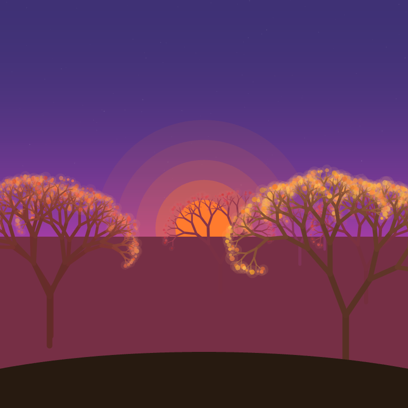
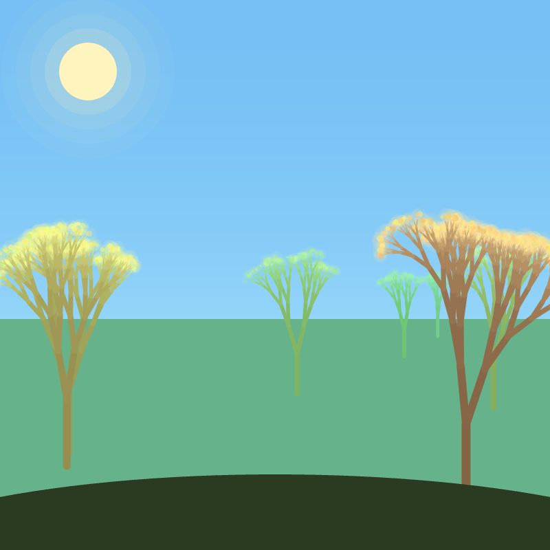
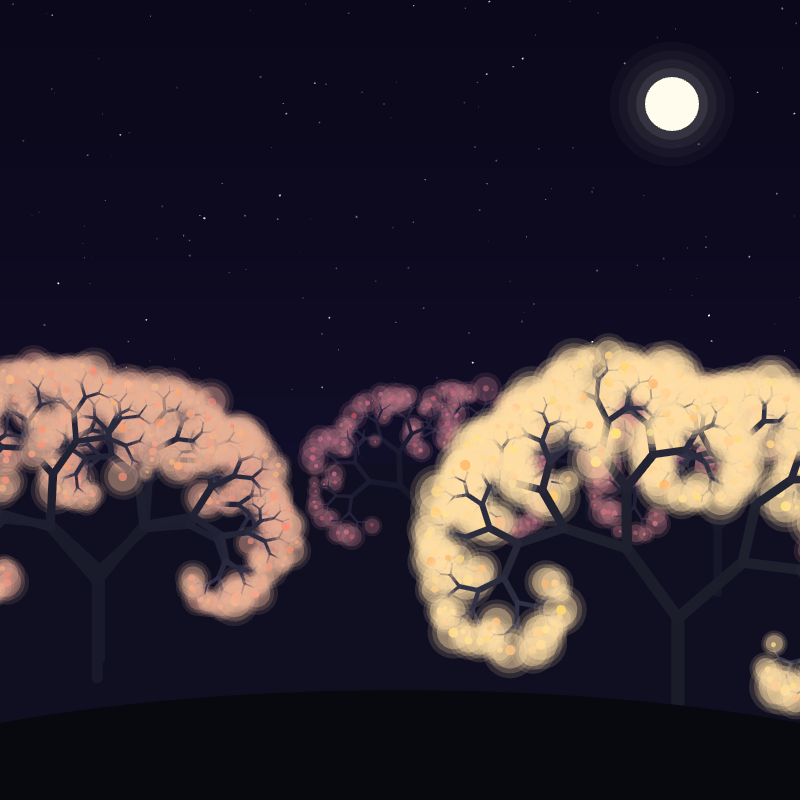

# Living Forest

Sidney Ngai, DM3008 Generative Art, Week 9: Fractals & Recursion



Demo video: [living-forest-demo.webm](living-forest-demo.webm) (30 s: the mouse sweeps from
midday to midnight, holds, then comes back to sunset)

## Synopsis

A forest of recursive trees under a sky that runs from midday to midnight as you move the
mouse from left to right. Every tree is the same rule: a branch is a line with two smaller
trees on its tip. As the light goes, the branches open up, the sun drops and becomes the
moon, the stars come out and the blossoms start to glow. The forest at midnight is the
same forest as at noon, just lit differently.

| Midday | Sunset | Midnight |
| --- | --- | --- |
|  |  |  |

## How it works

### The tree

`branch(len, depth, angle)` draws one line, moves the origin to the end of it with
`translate(0, -len)`, and then calls itself twice: once rotated left, once rotated right,
each inside `push()` / `pop()` so both children start from the same tip. Each child is
66–78% as long as its parent. When `depth` reaches 0, it draws a blossom instead of
branching again.

A tree of depth 9 is 2¹⁰ − 1 = 1023 branches. Small random changes to each angle and length
make every tree different. Calling `randomSeed(tree.seed)` at the start of each frame gives
the same random numbers every time, so a tree holds its shape instead of flickering. Wind
is `noise()` multiplied by how far up the tree the branch is, so the tips sway and the trunk
stays still.

### The forest

`makeForest()` places seven trees, spread from near to far. Distance controls everything
about a tree:

| | Near | Far |
| --- | --- | --- |
| trunk length | 118 px | 26 px |
| recursion depth | 9 | 6 |
| line weight | 100% | 38% |
| colour | its own | 62% blended into the sky |

The trees are sorted and drawn far to near, so near trees paint over far ones. The blend
into the sky colour (atmospheric perspective) is what makes small trees read as distant
rather than just small. Lowering the depth for far trees also saves work: a depth-6 tree
has 127 branches instead of 1023.

### Day and night

`mouseX` becomes one value, `u`, from 0 (midday) to 1 (midnight). Everything reads from
it: sky, ground, bark, twigs, blossoms, stars and the sun / moon. `triLerp()` blends three
colours (midday, sunset, midnight), so every colour in the scene passes through a sunset
on its way to night.

- **The sky** is redrawn every frame as 180 thin horizontal bands, a gradient between a
  top and a bottom colour.
- **The sun and moon** are one disc. It arcs across the sky on a sine curve, dips to the
  horizon at sunset, and gets bigger and redder there, then smaller and paler as the moon.
- **The stars** fade in after sunset and twinkle, each on its own phase.
- **Night glow.** After dark each blossom gets stacked, faint halos that spread wider and
  whiter. They add up where blossoms overlap, so the thick parts of the canopy glow more
  than the loose tips.
- **The branch angle** also follows the mouse, so the trees open up as the light goes.

## Controls

| Input | Action |
| --- | --- |
| Mouse left to right | midday → sunset → midnight, and the branches open up |
| `R` | grow a new forest |

## What I changed from the weekly starter

The weekly starter (Living Tree) was one tree under a fixed dusk sky, built up step by step
in class. I kept its `branch()` recursion and built a scene around it: the forest with depth
and haze, the live sky, the single sun / moon, the day / night colour ramps, the stars, the
ground and the night glow.

For the portfolio I removed the save-PNG key and moved the sketch to p5.js 1.11.11 to
match my other pieces.

## Running it

Open `LivingForest/index.html` in a browser, or serve the `LivingForest` folder with any
local web server. p5.js 1.11.11 is loaded from jsdelivr, so it needs an internet connection.

## Files

```
LivingForest/
  index.html      loads p5.js and sketch.js
  sketch.js       the whole piece, with the synopsis and attributions in its header
Images_Videos/
  README.md       this write-up
  living-forest-midday.png, -sunset.png, -midnight.png   stills across the day
  living-forest-demo.webm                                30 s screen recording
```

## Attributions

- The recursive `branch()` (a line, then two rotated children inside `push()` / `pop()`),
  the random angle and length jitter held still with `randomSeed()`, the `noise()` wind
  that only moves the tips, stroke weight and colour by depth, and `blossom()` at the tips
  come from the Living Tree starter (DM3008 week 9 class material, Ashley Hi).
- The forest, distance and haze, live sky, sun / moon, day / night colour ramps, stars,
  ground and night glow are my own.
- Built with [p5.js](https://p5js.org) 1.11.11.
