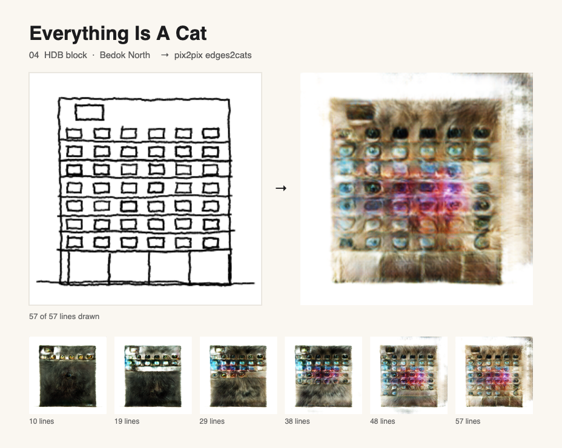

# Week 11 · Everything Is A Cat

Sidney Ngai · DM3008 Generative Art · Generative Adversarial Networks



## Concept

The weekly task (sketch2x) was to make a series of five images with one of the
pix2pix models from class. I picked `edges2cats`: a model that has only ever
been shown cat outlines next to cat photos, so whatever lines you give it, it
answers with a cat.

I drew five things from a Singapore day: kopi peng takeaway in a plastic bag, a
durian, the Merlion, an HDB block and an ice kachang. Every one of them comes
back as a cat. It felt right. In every estate the community cats quietly take
over the void deck, the kopitiam chair and the car park, and this model does
the same to everything I draw.

For the portfolio I wanted to show the moment the model decides "this is a
cat", not only the finished result. In the new version the drawing is made in
front of you one pen stroke at a time, and after every stroke the model is
asked again what it sees. The cat puts itself together while the drawing is
still being made: on the kopi bag the knot becomes ears long before the ice
cubes arrive and become eyes, and on the HDB block each new row of windows
becomes another row of eyes, until the whole block is staring back.

## How it works

**The shaky pen.** The drawings are not hand traced and not plain p5 shapes.
Every shape (line, rectangle, ellipse, arc, bezier, curve, triangle) is turned
into a list of points and passed through `shaky()`, which moves each point by
two layers of Perlin noise: a slow drift along the stroke (`DRIFT`) and a small
fast tremble (`WOBBLE`). Small shapes drift less than big ones so a window
stays a window. Lines overshoot or stop short at their ends, ellipses go a bit
past where they started, and every stroke gets its own weight. The result is
stored as a stroke instead of being drawn, so it can be played back later.

**Drawing it back.** `advancePen()` draws a few points of the current stroke
onto a 256 × 256 `p5.Graphics` each frame, which is the size the model was
trained on. The drawings are listed in the order a person would draw them (the
outline first, details last), which matters because the model's answer changes
with every stroke.

**Asking the model.** pix2pix takes about a second per image, much slower than
the pen. So `askModel()` only ever has one request out at a time. When a stroke
finishes, the drawing is marked as changed; when the model is free, it is sent
the drawing as it is now, and any in-between states are skipped. This is the
asynchronous idea from this week's lecture: the sketch keeps drawing while it
waits for the model, and reacts when the answer comes back (`.then`). If you
switch drawings while a request is out, the answer is thrown away because it
belongs to the old drawing.

**The filmstrip.** At every sixth of the drawing the pen pauses until the model
has answered, and that answer goes onto the filmstrip. This gives an even
record of the drawing becoming a cat, labelled with how many lines were down at
that moment.

**Your own drawing.** Drag on the left square to draw. The model is asked again
every time you let go, and the filmstrip keeps your last six. You can draw over
one of the five drawings or press C for a blank page.

**Loading the model.** The model file is 54MB, too big for GitHub's file limit,
so it is split into three parts in `EverythingIsACat/models/`. `preload()` loads them with
`loadBytes()`, and `setup()` joins them back into one file in memory and hands
its address to `ml5.pix2pix()`. The file is byte for byte the same as the
original `edges2cats_AtoB.pict`.

## What changed from the weekly submission

The weekly version (`weekly-sheet.png`) was one still sheet: five drawings, five
cats and a statement. Its drawings were already on the shaky pen. For the
portfolio:

1. The drawing is played back stroke by stroke and the model is asked again
   after every stroke, so the cat assembles itself live.
2. A request queue that keeps the model busy but never overloaded, always
   sending the newest drawing and ignoring answers to drawings that have been
   swapped out.
3. A six frame filmstrip that pauses the pen at even steps to record the
   drawing becoming a cat.
4. The new cat fades in over the previous one, so changes are visible rather
   than jumping.
5. Drawing your own lines, over one of the five drawings or on a blank page,
   with the cat updating each time you lift the pen.
6. Shapes are stored as strokes rather than drawn straight away, so the same
   wobble can be replayed (R) or skipped to the end (SPACE).
7. The model is split into three parts and rejoined in the browser, so the
   project can live on GitHub.
8. A new single drawing layout at 1.5× size with the filmstrip underneath.

## Controls

| Key | Action |
| --- | --- |
| 1 to 5 | Pick a drawing and watch it being drawn |
| Drag on the left | Draw your own lines (the cat updates when you let go) |
| C | Blank page |
| R | Replay the drawing from the start |
| SPACE | Finish the drawing now |
| S | Save the canvas as a PNG |

## How to run

The model is loaded with `loadBytes()`, so the sketch has to be served rather
than opened as a file:

```
cd EverythingIsACat
python3 -m http.server 8000
```

then visit `http://localhost:8000`. Loading the model takes a few seconds.
Keep the tab in front while it runs, because browsers pause background tabs
and the pen stops with them.

## Images and video

- `demo-all-five.webm`: screen recording of all five drawings being drawn and
  turning into cats.
- `cat-kopi.png`, `cat-durian.png`, `cat-merlion.png`, `cat-hdb.png`,
  `cat-iceKachang.png`: each finished drawing with its filmstrip.
- `cat-own.png`: a fish drawn by hand on a blank page, which becomes a black
  cat with a fin.
- `weekly-sheet.png`: the weekly submission, for comparison.

## Attribution

- Model loading with `ml5.pix2pix(...).ready.then(...)` and the call to
  `transfer()` come from Ashley Hi's Week 11 Pix2Pix demo (DN3008, 2026). In
  `sketch.js` every function is marked `template (Ashley Hi)`,
  `template modified by Sidney` or `new (Sidney)`. `setup()`, `askModel()`,
  `draw()` and `mousePressed()` are modified template functions; everything
  else is new.
- The `edges2cats_AtoB` model is from Dongphil Yoo's pix2pix-ml5-demo
  (github.com/dongphilyoo/pix2pix-ml5-demo), trained with pix2pix (Isola et al.,
  *Image-to-Image Translation with Conditional Adversarial Networks*, 2017) on
  the edges2cats data by Christopher Hesse.
- p5.js 1.9.4 and ml5.js 0.5.0, the versions used in the Week 11 class
  examples. ml5 is needed to run the model; there are no other libraries and
  no outside data.

## Reflection

The finished cat on its own is a joke. Watching it arrive is more interesting,
because you can see what the model holds on to. On the kopi bag, two loops at
the top were enough to commit it to ears, and it never changed its mind after
that. Everything drawn later had to fit around those ears. The durian went the
other way: with only the outline down there is a faint cat face in the middle,
and the spikes drawn on the surface later wipe it out, leaving a ball of black
fur with a glint on every spike. On the HDB block, each row of windows became a
row of eyes the moment it was drawn, top to bottom. So the model doesn't read
the drawing as a whole. It commits to whatever the strongest shapes suggest
right now, and later lines can confirm that or take it apart.

The part that took longest to get right was timing. The pen is much faster than
the model, and sending a request every stroke made the answers pile up and
arrive out of date. Allowing only one request at a time, always sending the
newest drawing, fixed that. It is the async lesson in a very practical form.

If I took it further I would let a group draw on one page together, each
person's stroke sent to the model in turn, to see whose lines the cat takes its
shape from.
